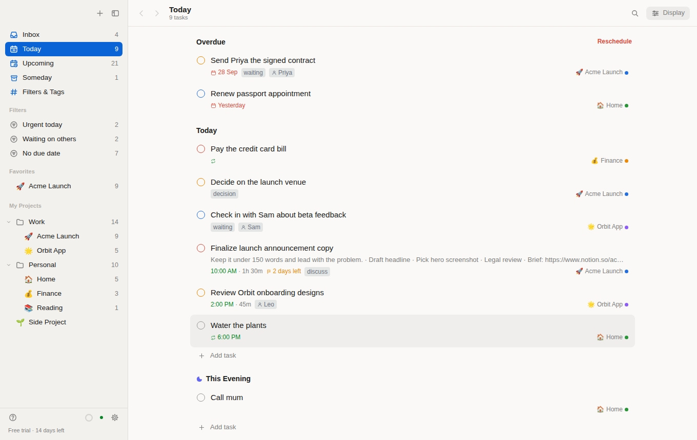
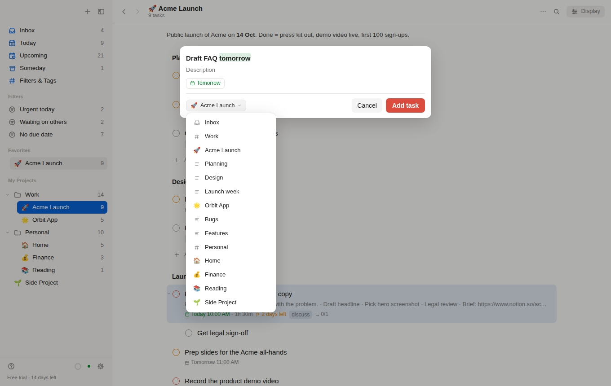
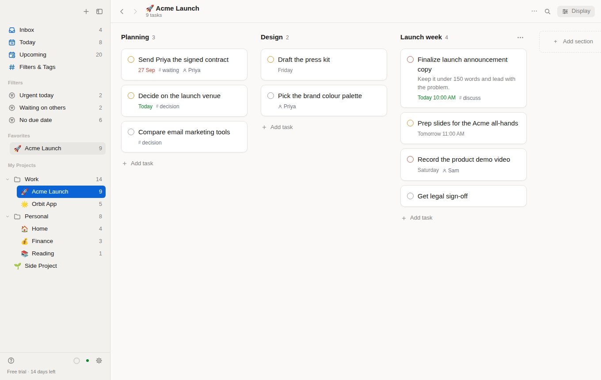
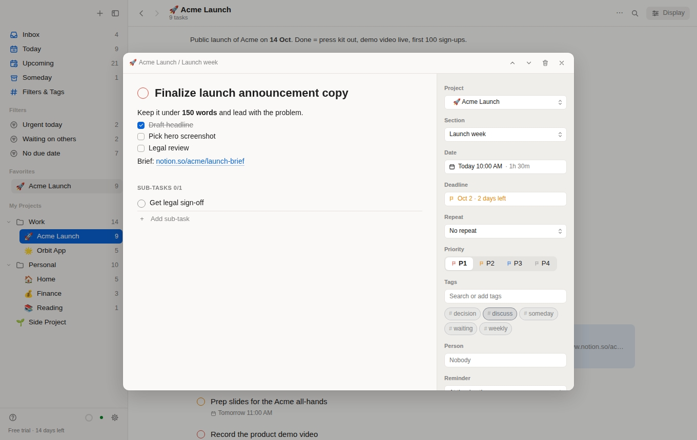
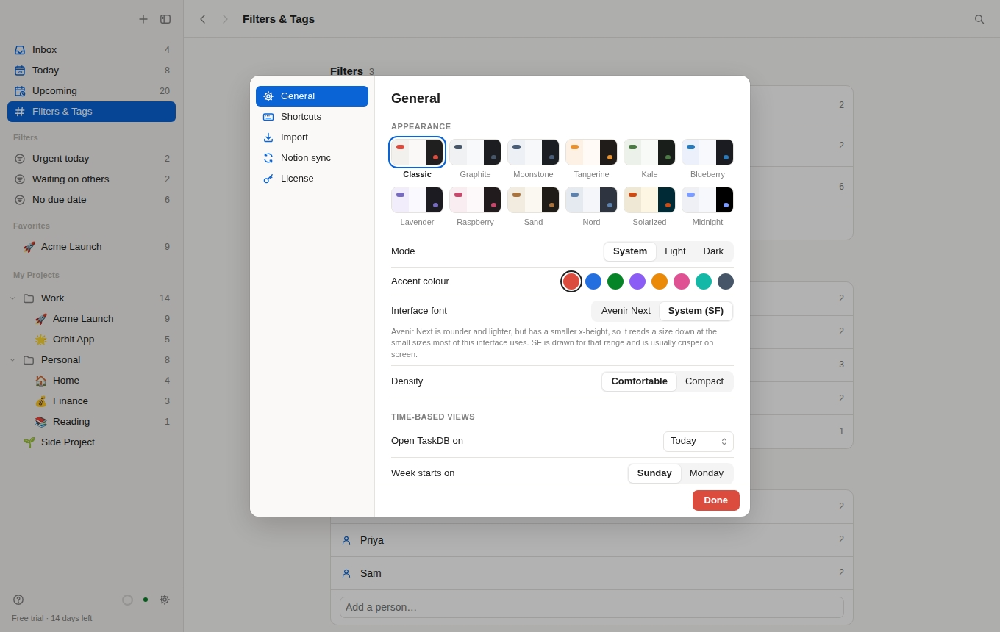

# TaskDB

**Fast, keyboard-first task management for the Mac, on top of your own Notion.**

Capture a task in one typed line, plan your week on lists, boards and a calendar, and move
through your day without reaching for the mouse, while every task stays in a Notion database you
own.



## Highlights

- **Your data stays in Notion.** Tasks live in your own workspace. There are no TaskDB servers.
- **Instant and offline.** A local copy makes every action immediate, and changes sync with Notion in the background.
- **Keyboard first.** Every everyday action is one key, and every key can be remapped.
- **Quick add in plain language.** `Call Priya tomorrow 5pm p1 #Work @waiting +Priya every mon`
- **List, Board and Calendar** for every view, with layout, grouping, sorting and filters remembered per view.
- **Deadlines, durations and smart repeats** that Notion can't do on its own.
- **Today, Upcoming, This Evening and Someday**, so nothing with a date or deadline slips.
- **12 themes**, light and dark mode, and a comfortable or compact layout.

## Features

### Capture in one line

Type `Draft FAQ tomorrow` and TaskDB highlights what it understood as you type: date, time,
priority, `#project`, `/section`, `@label`, `+person`, `for 45m` durations, `{oct 5}` deadlines
and `every monday` repeats. Pick a project or section from the list without typing `#`, paste a
list to add many tasks at once, or press `⌘⇧Space` to add a task from any app.



### A board for any project

A project's sections become columns; drag a card to move it between them. Any view can be grouped
into columns by day, section, priority, label or project, and the Overdue column reschedules
everything in it in one step. Projects can have emoji, colours, nesting, favourites, notes and
templates.



### Everything about a task, one key away

Press `I` or Return to edit title, Markdown notes with checklists and links, project, section,
date and duration, deadline, repeat, priority, tags, person and reminder. Add sub-tasks, and step
to the previous or next task without closing the panel.



### Planning that goes beyond Notion

- **Deadlines** separate from due dates, with a calm countdown flag ("2 days left") that turns red when due.
- **Durations** that size blocks on the calendar, so it works as a time-blocking view.
- **Advanced repeats**: `every!`, `every 15th`, `every last day`, `every 1st mon`, `every jan 15`, `until …`, plus skipping one occurrence.
- **Relative reminders** ("15 min before", "Day before, 9 AM") as native Mac notifications.
- **Calendar** in day, 3-day, week and month layouts; drag a task to a day or an hour.
- **Saved filters** like `p1 & (today | overdue)` with live counts in the sidebar, and labels and people you can rename or remove everywhere at once.
- **Productivity**: daily and weekly goals, streaks, days off and charts.

### Make it yours

Choose from 12 themes (Classic, Graphite, Moonstone, Tangerine, Kale, Blueberry, Lavender,
Raspberry, Sand, Nord, Solarized and a true-black Midnight), light, dark or system mode, an accent
colour, the interface font, comfortable or compact density, the view TaskDB opens on, and which
day your week starts.



### Built for the keyboard

Every everyday action is a single key, and the single-key shortcuts can be changed in Settings.
Press `?` in the app for the full list.

| Key | Action | Key | Action |
| --- | --- | --- | --- |
| `Q` or `A` | Quick add | `T` | Due today |
| `E` | Complete | `U` or `M` | Due tomorrow |
| `J` / `K` or `↓` / `↑` | Next / previous task | `W` | Due this weekend |
| `I` or Return | Open details | `N` | Due next week |
| `L` | Edit labels | `S` / `D` | Pick a date / deadline |
| `1` – `4` | Priority | `⇧E` / `⇧S` | This evening / Someday |
| `X` | Select several tasks | `0` | Remove the due date |
| `⌘K` or `/` | Command palette | `⌘Z` | Undo |
| `⌘[` / `⌘]` | Back / forward | `⌘⇧C` | Copy the Notion link |

### Connect in one click

Sign in with Notion and TaskDB sets up its database for you, or paste a Notion secret if you
prefer. A short tour and a practice project teach each feature by doing it.

## Your data

- Every task is a page in a Notion database in your own workspace. Edit it in TaskDB or in Notion; changes flow both ways.
- Your Notion access token and license key are stored in your Mac's Keychain.
- There are no TaskDB servers. Sync is local-first and paced around Notion's rate limit; see [SPEC.md](SPEC.md).
- If you stop using TaskDB, your tasks stay in Notion.

## Install

Requires macOS 11 or later and a Notion account (the free plan works).

1. Download the DMG and drag **TaskDB** to Applications.
2. TaskDB isn't notarized yet, so macOS blocks it the first time. Double-click it, click **Done**,
   then open **System Settings › Privacy & Security** and click **Open Anyway**.
   If macOS says the app is "damaged", run `xattr -cr /Applications/TaskDB.app` once in Terminal.
3. Click **Connect with Notion** and follow the welcome tour.

TaskDB is free for 14 days, no card needed.

## Development

```bash
npm install
npm run dev        # browser demo with a fake Notion and sample data: http://localhost:1420
npm run tauri dev  # desktop app with real Notion
npm test           # sync engine, quick-add parser, recurrence, filters
npm run typecheck
```

| Path | What |
|---|---|
| `src/sync` | Rate limiter, outbox, sync engine, poll scheduler |
| `src/notion` | Notion API client, property mapping, database setup |
| `src/core` | Quick-add parser, recurrence, filter language, dates |
| `src/app` | React UI and the controller it talks to |
| `src-tauri` | macOS shell: Keychain, menu bar, notifications, hotkey |

Every screenshot above uses made-up sample data.

TaskDB is not affiliated with or endorsed by Notion.
